<h3><code>hebaalazzeh@github ~ $ ./contributions.sh</code></h3>

<h3><code>hebaalazzeh@github ~ $ whoami</code></h3>

<h3><code>hebaalazzeh@github ~ $ neofetch</code></h3>

<h3><code>hebaalazzeh@github ~ $ ./links.sh</code></h3>

**CS @ UC Berkeley ✦ prev @ Google, Uber, Snapchat ✦ AI research @ Stanford ✦ LinkedIn Next Gen Voices creator ✦ ColorStack ✦ RTC ✦ GWC ✦ Cal Hacks ’26 ✦ GHC ’26 ✦ YC SU ’26**

   
   

