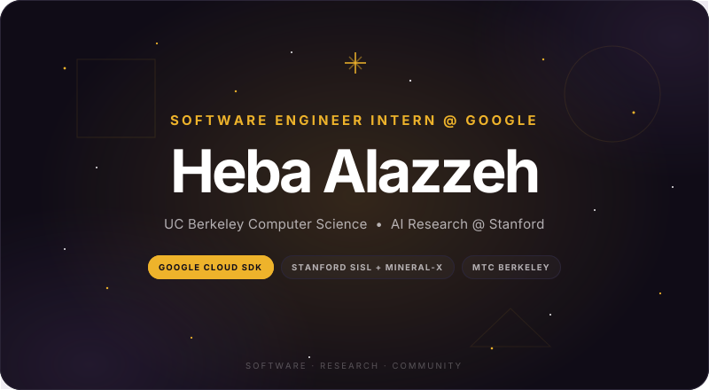
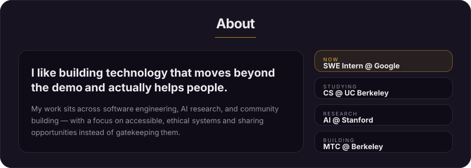
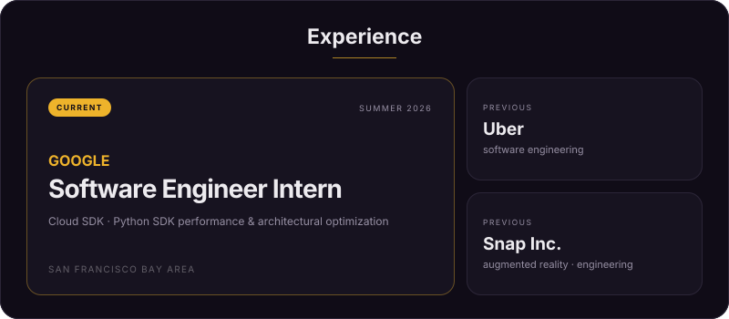
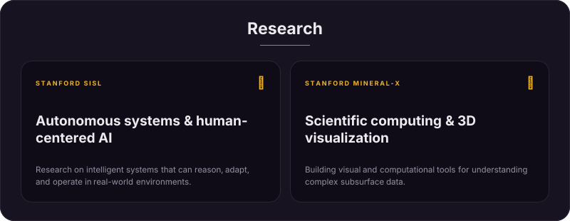
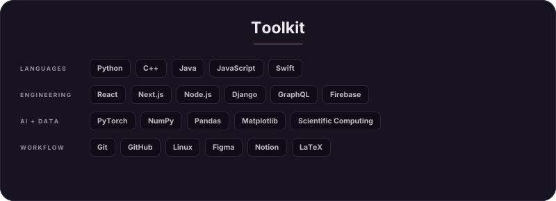
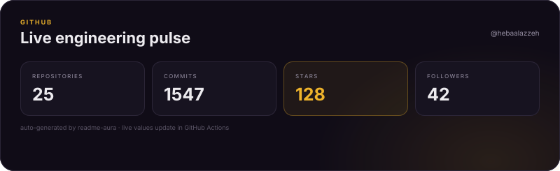
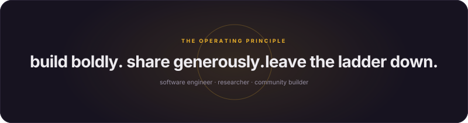

<h3><code>hebaalazzeh@github ~ $ ./contributions.sh</code></h3>

<h3><code>hebaalazzeh@github ~ $ whoami</code></h3>

<h3><code>hebaalazzeh@github ~ $ neofetch</code></h3>

<h3><code>hebaalazzeh@github ~ $ ./links.sh</code></h3>

**CS @ UC Berkeley ✦ prev @ Google, Uber, Snapchat ✦ AI research @ Stanford ✦ LinkedIn Next Gen Voices creator ✦ ColorStack ✦ RTC ✦ GWC ✦ Cal Hacks ’26 ✦ GHC ’26 ✦ YC SU ’26**

 

<h3><code>hebaalazzeh@github ~ $ ./portfolio.sh</code></h3>

designed to mirror <a href="https://hebaalazzeh.github.io/">hebaalazzeh.github.io</a> · rendered with <a href="https://github.com/collectioneur/readme-aura">readme-aura</a> 

